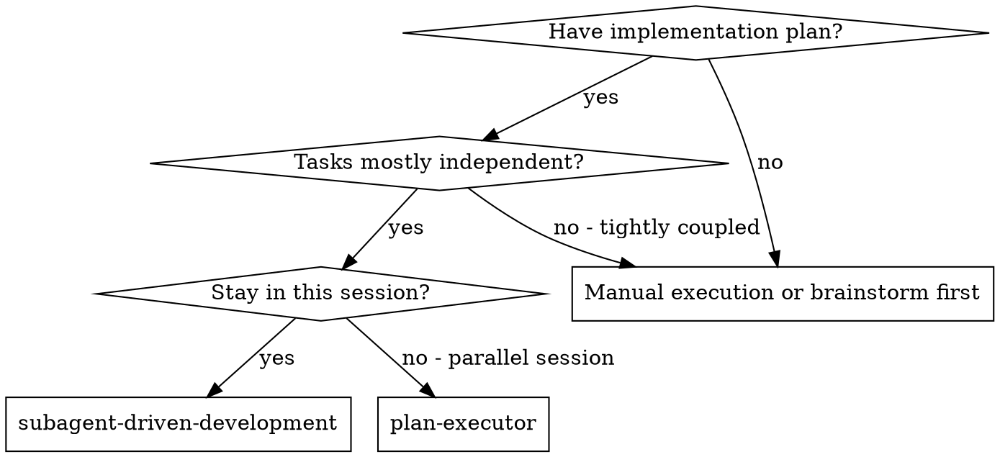
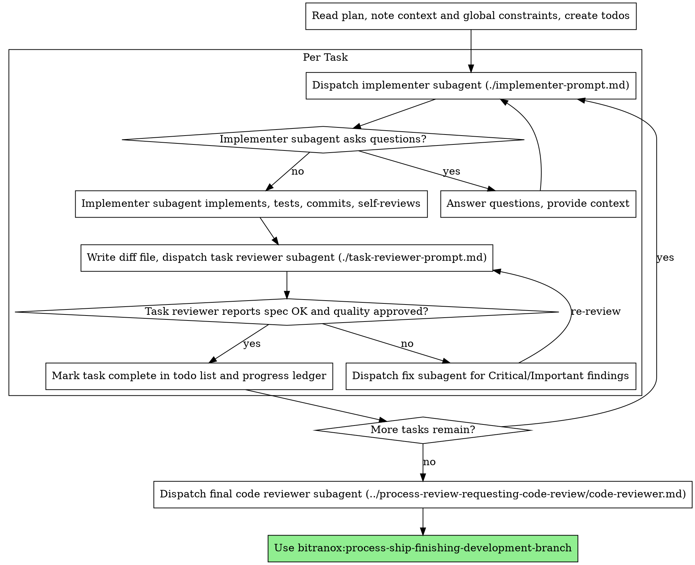

# Subagent-Driven Development

> Adapted from the superpowers plugin (MIT).

Execute plan by dispatching a fresh implementer subagent per task, a task review (spec compliance + code quality) after each, and a broad whole-branch review at the end.

**Why subagents:** You delegate tasks to specialized agents with isolated context. By precisely crafting their instructions and context, you ensure they stay focused and succeed at their task. They should never inherit your session's context or history  -  you construct exactly what they need. This also preserves your own context for coordination work.

**Core principle:** Fresh subagent per task + task review (spec + quality) + broad final review = high quality, fast iteration

**Pathfinder:** instruct each implementer to leave files better than found and accept no technical debt;
an out-of-scope fix a subagent spots goes in its own worktree (`bitranox:git-worktrees`), surfaced not
bolted on. See `bitranox:meta-self-improve` ("Pathfinder discipline").

**Narration:** between tool calls, narrate at most one short line  -  the
ledger and the tool results carry the record.

**Continuous execution:** Do not pause to check in with your human partner between tasks. Execute all tasks from the plan without stopping. The only reasons to stop are: BLOCKED status you cannot resolve, ambiguity that genuinely prevents progress, or all tasks complete. "Should I continue?" prompts and progress summaries waste their time  -  they asked you to execute the plan, so execute it.

## When to Use

**vs. Executing Plans (parallel session):**
- Same session (no context switch)
- Fresh subagent per task (no context pollution)
- Review after each task (spec compliance + code quality), broad review at the end
- Faster iteration (no human-in-loop between tasks)

## The Process

## Pre-Flight Plan Review

Before dispatching Task 1, scan the plan once for conflicts:

- tasks that contradict each other or the plan's Global Constraints
- anything the plan explicitly mandates that the review rubric treats as a
  defect (a test that asserts nothing, verbatim duplication of a logic block)

Route each finding by what its fix would change, the same test the review
loop applies to a plan-mandated finding. A fix that only makes a task obey a
rule the plan itself states (a Global Constraint, say) or only adds tests is
yours: log it in `EXECUTION-USER-REVIEW.md` with a reopen-if line and pass it
to that task's implementer as an earlier finding. Choosing between two tasks
that contradict each other always changes the plan text, so it is never
yours. Present the rest, the findings whose fix changes what the plan TEXT
requires, to your human partner as one batched question  -  each finding
beside the plan text that mandates it, asking which governs  -  before
execution begins, not one interrupt per discovery mid-plan. If the scan is
clean, proceed without comment. The review loop remains the net for
conflicts that only emerge from implementation.

**Check the plan's SHAPE in the same pass.** `task_brief.py` extracts a task by its
`Task <id>` heading and prepends the plan's `Global Constraints` section. A plan written in plan
mode as Context / Design / Verification prose, or with its tasks as a numbered list
(`1. **Spike**: ...`) or as numbered sections (`## 1. Parser`), has neither, and the script exits 1
saying the plan has no task headings at all. Do not hand-cut briefs with `sed`: they lose the
constraints block, and with it the decisions every task relies on. Restructure the PLAN first,
content unchanged: the decisions, measured facts and design under `## Global Constraints`, one
`### Task <id>: <name>` heading per task. Commit it where the plan is tracked, and log the
restructure in `EXECUTION-USER-REVIEW.md` as a decision you took.

**A task that ADDS or TIGHTENS a refusal** (a new validator, an empty-directory check, a stricter
path rule) also breaks every existing test, fixture and doc example that relied on the old
leniency, and those are part of the task. Before dispatching it, find them: grep the tests and
fixtures for the shape the new check refuses, or apply only the new check with compuse-toolbox's
`mutation_arm --mutate` and run the affected test files once. Name each one in the task's Files
list (amend the plan and regenerate the brief). A brief silent about them reaches the implementer
as a STOP, or as a test edit nobody can explain in review.

**Plan mode must have ended before the first dispatch.** A subagent dispatched
while the session is still in plan mode has been observed to inherit it: it
explores, writes a plan file of its own and returns "ready to execute on
approval" instead of code. A user who approves by REJECTING the ExitPlanMode
call with approving text ("yes, do it") has not ended plan mode, and the
session can stay in it for several turns. Before dispatching an implementer,
confirm plan mode has actually ended: the "Exited Plan Mode" notice has
arrived, or a Write outside the plan file succeeds. An implementer that comes
back with a plan and no code is obeying the mode, not being timid: resume that
same agent with an approval message via SendMessage ("approved, execute now")
rather than re-dispatching from scratch, since its plan and context are
already right. Plan mode switched on while writers are ALREADY running is a different case, with
code already written: see "Interrupted Runs".

## Model Selection

There are two working tiers: `haiku` for purely mechanical work, `opus` for everything else
(`fable`, above `opus`, is a rare exception for single judgments - see "Concrete tiers"). The test
is whether anything is JUDGED: if the output follows from the input by a fixed rule (match a
regex, copy, reformat, transcribe given code), it is mechanical; the moment the agent decides
whether something is a violation, a duplicate, relevant or correct, it is `opus`.

**Mechanical implementation tasks** (the plan text holds the complete CODE, or a single-file
mechanical fix): `haiku`. A complete spec written as prose is not complete code: `opus`.

**Everything else** - integration, judgment, debugging, review, architecture and design, the final
whole-branch review: `opus`. Every review also carries effort `medium` (see "Review dispatches").

**Always specify the model explicitly when dispatching a subagent.** An
omitted model inherits your session's model, which may be a premium tier or a
weaker one - either way it silently defeats this section. This is ENFORCED, not
just documented: **arm the model gate before dispatching Task 1** -

    bash "$CLAUDE_PLUGIN_ROOT/hooks/run-python.sh" "$CLAUDE_PLUGIN_ROOT/hooks/skill_receipt.py" start plan-execution

While that `plan-execution` receipt is fresh, the PreToolUse
`subagent-model-gate` hook DENIES any `Task`/`Agent` dispatch that omits
`model` (a `fork` stays exempt - it legitimately inherits the parent model).
When the plan is complete (after the final review), DISARM it -

    bash "$CLAUDE_PLUGIN_ROOT/hooks/run-python.sh" "$CLAUDE_PLUGIN_ROOT/hooks/skill_receipt.py" end plan-execution

Outside an armed plan execution the same hook only warns. The receipt belongs to the SESSION
and expires 8 hours after its latest `start`: a session that resumes a plan after a handover,
`/clear` or restart, or a run past 8 hours, runs `start` again before its next dispatch
(`skill_receipt.py check plan-execution` exits 0 while this session holds a fresh one).

### Review dispatches: `opus` at effort `medium`

Every dispatch whose job is to JUDGE work or a verdict already produced runs on `model: "opus"`
with `effort: "medium"`: the per-task reviewer and its re-reviews, the final whole-branch review,
code review, skeptic and adversarial lenses, verify passes, adjudicators, quote-back checks, audit
reviewers and judge panels. A fan-out of such reviewers (one per file, dimension or store) is a
review too; a scanner that judges raw material nobody has produced a result from yet (log lines,
search hits, records) is not, and takes the non-review `opus` row below. This paragraph is the
explicit ask the Agent tool's `effort` field requires, so pass the field on every such dispatch.
On a Workflow `agent()` call pass `{model: 'opus', effort: 'medium'}`; on a headless reviewer pass
`claude -p --model opus --effort medium`. Name the field even when it looks redundant: an omitted
field inherits the session or settings default, which is often higher (on one measured prompt, an
opus reviewer with no field spent about twice the output tokens it spent at `medium`). Never send
a review as a `fork`: a fork ignores both fields and runs on the parent's model and effort.

It does NOT cover implementers and fixers, scenario writers, RED/GREEN and baseline probe
subjects, the final synthesis (it keeps `xhigh` or `max`, see the table below), or `haiku`
mechanical scans (they keep `low`): a probe is the thing under test, and its tier pairs stay as
`bitranox:meta-skill-writer` prescribes. `subagent-model-gate` warns on a review-shaped dispatch
that is missing either value.

### Reasoning effort: the channels and the levels

Three channels set a subagent's reasoning effort: the Agent tool's own `effort` field, which
the tool permits ONLY when the user, CLAUDE.md or a skill step explicitly asks for a level (it is
ignored for a `fork`); an agent-type definition's `effort` frontmatter; and a Workflow `agent()`
call's `opts.effort`. The knob swings the thinking budget by orders of magnitude, so set it only
at the EXTREMES and leave everything else at the default (inherit); reviews are the one exception
and carry `medium` (see "Review dispatches"). How each channel behaves, including why a definition
added mid-session cannot be dispatched: [references/model-tiers.md](references/model-tiers.md).

| Role                                                | Effort                                       |
|-----------------------------------------------------|----------------------------------------------|
| `haiku`-tier mechanical scan / transcribe / extract | `low` (the big saver on fleet-scale fan-out) |
| Any review (see "Review dispatches")                | `medium` on `opus`                           |
| Non-review `opus` fan-out / judgment / reasoning    | inherit - do not set                         |
| Final synthesis                                     | `xhigh` or `max`                             |

Set these through an agent-type definition or a Workflow `agent()` call freely; on an Agent-tool
dispatch, only once the user, CLAUDE.md or a skill step has asked for a level - a review dispatch
is always asked (see "Review dispatches").

### Concrete tiers (canonical mapping - other skills reference this section)

Map the generic tiers to the current Claude lineup, and pass the **stable tier ALIAS**
(`haiku` / `opus`), never a pinned version like `claude-opus-4-8` - the alias
auto-resolves to the latest model in that tier, so `opus` is always the newest Opus and a new
version needs no edit.

- **`haiku`** (cheap, fastest) = purely mechanical / transcription / pattern-scan with no
  judgment: regex secret/PII scans, license accept-reject mapping against a fixed table,
  formatting, 1-2-file implementers whose brief holds the complete code.
- **`opus`** (the DEFAULT for everything that is not purely mechanical) = fan-out that judges
  (per-file/per-dimension/per-store reviewers at effort `medium`, and scanners that judge what
  they find at inherited effort - fanned out or not, the judging decides the tier, not the
  fan-out), bounded judgment, relevance filtering, summarizing, integration, reference hunting,
  implementers working from prose, architecture/design, final SYNTHESIS, root-cause judgment, and
  adversarial CORRECTNESS verification and the final whole-branch review, both at effort `medium`.
- **`fable`** (Mythos-class, ABOVE opus; premium-priced and only available on paid API credits -
  many plans cannot resolve it) = the exceptional top tier for the hardest single judgments where
  even opus-level error is too costly. Use sparingly and only where the plan/credits allow;
  `opus` stays the universally-available default.

**`sonnet` is not a tier here.** Across a whole job it costs more than `opus`: it takes more turns
and more reasoning tokens for the same work, which outweighs its lower price per token. Do not
fall back to it for "cheaper" fan-out; the only step down from `opus` is `haiku`, and only for
purely mechanical work. The `subagent-model-gate` hook warns on a dispatch pinned to `sonnet`.

Do NOT use `fable` for fan-out or mechanical work, and do NOT leave any dispatch on the session
default. The lineup ages: the model hierarchy is
re-evaluated periodically by `bitranox:meta-dream-tree` (it asks the `claude-code-guide` agent for the
current Claude model lineup and proposes a re-tier if the ordering shifts), so this mapping stays current.

**Turn count beats token price.** Wall-clock and context cost scale with how
many turns a subagent takes, and cheaper models routinely take 2-3× the
turns on multi-step work  -  costing more overall. That is why `opus` is the
floor for reviewers (at effort `medium`) and for implementers working from prose descriptions.
When the task's plan text contains the complete code to write, the
implementation is transcription plus testing: use `haiku` for
that implementer. Single-file mechanical fixes also take `haiku`.

**Task complexity signals (implementation tasks):**
- Touches 1-2 files and the brief holds the complete code, or is a single-file mechanical fix → `haiku`
- Anything else → `opus`

### The session model is fixed: delegate, or offer a choice for inline work

The MAIN (session) agent's model is FIXED for the turn and CANNOT be self-switched: no primitive
reads or sets it and no hook can make a switch, so the ONLY way to run a sub-task on a different
tier is a subagent with its own pinned `model`. "Save the model, switch, switch back" is NOT
implementable - never write a skill step that assumes it. A USER-driven `/model` switch keeps the
conversation, so offering one is legitimate in both directions (up for an inline deep judgment,
down for cost on a long routine stretch); it is the user's call. The hook and harness detail behind
this: [references/model-tiers.md](references/model-tiers.md).

A model-sensitive step therefore has TWO branches - decide delegability FIRST, and only then the model:

1. **Delegable (can/should run in a subagent) -> dispatch a subagent pinned to the warranted tier.**
   No user prompt; the model travels with the subagent. If a step can be a subagent, do that and pin
   its model - never route it back through the inline branch.
2. **Genuinely-inline (needs the full live main context, so NOT delegable) -> the only model lever is
   the session model.** If the session is AT the warranted tier, proceed silently. Otherwise (the
   session model is below OR above it), ask the user, two options only: **switch the session model to
   `<proposed>` via `/model` and re-run** (recommended, listed first), or **continue inline on
   `<current>`**. The proposed tier may be higher (a correctness risk to fix) or lower (a cost saving
   to capture); the switch-or-continue call is the user's. Never offer a subagent here - choosing
   "inline" already means the step is not delegable, so a subagent option contradicts the premise. In
   `auto` memory-mode do NOT ask: continue on the current model and log a one-line note that
   `<proposed>` would fit better (auto cannot self-switch, and switching needs a human `/model` action).

## Handling Implementer Status

Implementer subagents report one of four statuses. Handle each appropriately:

**DONE:** Generate the review package (`python3 "$CLAUDE_PLUGIN_ROOT/skills/process-agents-subagent-driven-development/scripts/review_package.py" BASE HEAD`, run from the repository under review (it resolves BASE/HEAD and its output directory from the current working directory)  -  it prints the unique file path it wrote; BASE is the commit you recorded before dispatching the implementer  -  never `HEAD~1`, which silently drops all but the last commit of a multi-commit task), then dispatch the task reviewer with the printed path.

**DONE_WITH_CONCERNS:** The implementer completed the work but flagged doubts. Read the concerns before proceeding. If the concerns are about correctness or scope, address them before review. If they're observations (e.g., "this file is getting large"), note them and proceed to review.

**NEEDS_CONTEXT:** The implementer needs information that wasn't provided. Provide the missing context and re-dispatch.

**BLOCKED:** The implementer cannot complete the task. Assess the blocker:
1. If it's a context problem, provide more context and re-dispatch with the same model
2. If the task requires more reasoning, re-dispatch with a more capable model
3. If the task is too large, break it into smaller pieces
4. If the plan itself is wrong, decide it as for a plan-mandated finding (see the review loop): escalate to the human when the fix changes what the plan text requires

**Never** ignore an escalation or force the same model to retry without changes. If the implementer said it's stuck, something needs to change.

**A claim in a report is the subagent's own inference.** "X is redundant", "Y is orphaned",
"Z is the cause", "tool T deletes an empty variable": before you relay such a claim to your human
partner, who may act on it, or forward it into a later brief, fix dispatch or plan amendment,
check its premise with one direct read or probe. If you cannot, carry it labelled: "unmeasured,
from the Task 3 report". A relayed claim arrives with your authority: the user turns it into an
instruction, and a fixer writes it into code comments, docs and a CHANGELOG line. The same goes
for a number that moved between rounds without a reason given (a test count that dropped):
explain it before the task counts as complete.

## Handling Reviewer WARN Items

The task reviewer may report "WARN Cannot verify from diff" items  -  requirements
that live in unchanged code or span tasks. These do not block the rest of the
review, but you must resolve each one yourself before marking the task
complete: you hold the plan and cross-task context the reviewer
lacks. If you confirm an item is a real gap, treat it as a failed spec
review  -  send it back to the implementer and re-review.

## Constructing Reviewer Prompts

Per-task reviews are task-scoped gates. The broad review happens once, at the
final whole-branch review. When you fill a reviewer template:

- Do not add open-ended directives like "check all uses" or "run race tests
  if useful" without a concrete, task-specific reason
- Do not ask a reviewer to re-run tests the implementer already ran on the
  same code  -  the implementer's report carries the test evidence
- Do not pre-judge findings for the reviewer  -  never instruct a reviewer to
  ignore or not flag a specific issue. If you believe a finding would be a
  false positive, let the reviewer raise it and adjudicate it in the review
  loop. If the prompt you are writing contains "do not flag," "don't treat X
  as a defect," "at most Minor," or "the plan chose"  -  stop: you are
  pre-judging, usually to spare yourself a review loop.
- The global-constraints block you hand the reviewer is its attention
  lens. Copy the binding requirements verbatim from the plan's Global
  Constraints section or the spec: exact values, exact formats, and the
  stated relationships between components ("same layout as X", "matches
  Y"). The reviewer's template already carries the process rules (YAGNI,
  test hygiene, review method)  -  the constraints block is for what THIS
  project's spec demands.
- Hand the reviewer its diff as a file: run this skill's
  `python3 "$CLAUDE_PLUGIN_ROOT/skills/process-agents-subagent-driven-development/scripts/review_package.py" BASE HEAD` (from the repo under review) and pass the reviewer the file path
  it prints (or, without bash: `git log --oneline`, `git diff --stat`,
  and `git diff -U10` for the range, redirected to one uniquely named
  file). The output never enters your own context, and the reviewer sees
  the commit list, stat summary, and full diff with context in one Read
  call. Use the BASE you recorded before dispatching the implementer  - 
  never `HEAD~1`, which silently truncates multi-commit tasks.
- Tests written FROM the plan encode its assumptions, so they cannot catch
  a defect IN the plan: when the plan is wrong, the implementation and its
  tests agree with each other and are wrong together, and the gate stays
  green. Treat the plan as a hypothesis under review. Give the reviewer
  the shipped code, not only the brief and the plan: the review package
  (the diff with its HEAD context), plus an instruction to Read the
  changed files at HEAD where a hunk is not enough. Say in the dispatch
  that a finding contradicting the plan is still a finding: it reports it
  labeled plan-mandated, at the severity the reviewer template's rubric
  gives it (a rubric defect the plan mandates is Important there).
- A dispatch prompt describes one task, not the session's history. Do not
  paste accumulated prior-task summaries ("state after Tasks 1-3") into
  later dispatches  -  a real session's dispatch hit 42k chars of which 99%
  was pasted history. A fresh subagent needs its task, the interfaces it
  touches, the global constraints, and any earlier review finding restated as
  a short rule (see "Stale brief" under File Handoffs). Nothing else.
  A rule you stated only in an earlier dispatch does not exist for the next
  subagent, which inherits no earlier prompt. Put every standing rule (who
  may spend money or reach a network, what is read-only, what must never be
  committed) into the plan's Global Constraints, which every brief opens
  with, never into one dispatch; when an agent breaks a rule, first check
  that it was in THAT agent's dispatch.
- Dispatch fix subagents for Critical and Important findings. Record Minor
  findings in the progress ledger as you go, and point the final
  whole-branch review at that list so it can triage which must be fixed
  before merge. A roll-up nobody reads is a silent discard.
- Minors never get a fix round of their own. A review with no open
  Critical or Important finding completes the task, so do not put a
  minor-only round to the user as the recommended option either - a project
  rule like "accept no technical debt" is met by the ledger and the final
  review's triage, not by fixing now. Every fix round is new code the next
  re-review reads with fresh eyes, so rounds for minors breed more minors:
  that is how one task reached ten fix rounds. A Minor that contradicts a
  user decision goes to the final review flagged for the user.
- A finding labeled plan-mandated  -  or any finding that conflicts with
  what the plan's text requires  -  is decided by what its FIX changes.
  If the fix only makes the plan's code obey a rule the plan itself states
  elsewhere, or only adds tests, dispatch the fix yourself and log the
  decision in the git-ignored `EXECUTION-USER-REVIEW.md` at the repo root,
  with a reopen-if line naming what would make it the human's question
  after all. Any other fix, one that changes what the plan TEXT requires
  the task to do, is the human's decision: present the finding and the
  plan text, ask which governs, and do not dispatch that fix without
  asking. Never dismiss a finding because the plan mandates it.
- A regression test that comes with a fix is only a restatement until it
  FAILS against the defect. Require the fix report to show it failing with
  the exact defect the fix removes put back: compuse-toolbox's
  `mutation_arm --revert FILE <pre-fix commit>` runs it against the
  pre-fix text, or `--mutate` reintroduces the defect, or a copy in a
  fresh `mktemp -d` dir (see "Proving a Test Can Fail by Mutating Code" in
  implementer-prompt.md). A test that passes there does not discriminate.
- The final whole-branch review gets a package too: run
  `python3 "$CLAUDE_PLUGIN_ROOT/skills/process-agents-subagent-driven-development/scripts/review_package.py" MERGE_BASE HEAD` (from the repo under review; MERGE_BASE = the commit the
  branch started from, e.g. `git merge-base main HEAD`) and include the
  printed path in the final review dispatch, so the final reviewer reads
  one file instead of re-deriving the branch diff with git commands.
- Every fix dispatch carries the implementer contract: the fix subagent
  re-runs the tests covering its change and reports the results. Name the
  covering test files in the dispatch  -  a one-line fix does not need the
  whole suite. Before re-dispatching the reviewer, confirm the fix report
  contains the covering tests, the command run, and the output; dispatch
  the re-review once all three are present.
- If the final whole-branch review returns findings, dispatch ONE fix
  subagent with the complete findings list  -  not one fixer per finding.
  Per-finding fixers each rebuild context and re-run suites; a real
  session's final-review fix wave cost more than all its tasks combined.

## File Handoffs

Everything you paste into a dispatch prompt  -  and everything a subagent
prints back  -  stays resident in your context for the rest of the session
and is re-read on every later turn. Hand artifacts over as files:

- **Task brief:** before dispatching an implementer, run this skill's
  `python3 "$CLAUDE_PLUGIN_ROOT/skills/process-agents-subagent-driven-development/scripts/task_brief.py" PLAN_FILE N` (from the repo under review)  -  it extracts the task's full text to a
  uniquely named file and prints the path. The brief opens with the plan's
  `Global Constraints` section, verbatim: a constraint that names the
  tasks it binds ("applies to Tasks 1, 2 and 6, so tests/test_launch.py is
  in scope") lives there and not in the task, so without it the task's
  Files list reads complete and is wrong. A plan that files constraints
  under any other heading gets none of them carried: reconcile the brief's
  Files list against those constraints yourself and forward each one that
  names this task. Exit 1 means no such task; exit 2 with a list of
  `line N:` headings means two headings share the id (a plan whose phases
  restart numbering) - never dispatch the pair as one task: ask the human
  which heading is meant, as for a plan contradiction whose fix changes
  the plan text, and re-run once
  the plan gives each its own id.
  Compose the dispatch so the
  brief stays the single source of requirements. Your dispatch should
  contain: (1) one line on where this task fits in the project; (2) the
  brief path, introduced as "read this first  -  it is your requirements,
  with the exact values to use verbatim"; (3) interfaces and decisions
  from earlier tasks that the brief cannot know; (4) your resolution of
  any ambiguity you noticed in the brief; (5) the report-file path and
  report contract. Exact values (numbers, magic strings, signatures, test
  cases) appear only in the brief. Never add a merge, version bump, release or build step to an
  implementer or fixer dispatch: the agent does it before any independent review, and a defect
  the review finds is already on the main branch. You merge once the task review is clean; a
  release or build is a dispatch of its own after that.
- **Before you send any dispatch**, read the assembled prompt once more for two things that
  make an agent answer confidently from nothing:
  - an unfilled placeholder token (`EXCERPT_PLACEHOLDER`, `[BRIEF_FILE]`, `<paste here>`) left
    from a template or an earlier dispatch: the agent runs with no material and returns an
    empty or invented answer instead of asking;
  - a path that does not exist where the agent runs. A worktree holds only TRACKED files, so a
    project `CLAUDE.md` (or any doc you point at) that is untracked or gitignored is absent from
    every worktree: check with `git ls-files --error-unmatch CLAUDE.md` and, when it is not
    tracked, give the main checkout's absolute path instead. The same goes for a report path:
    name one the agent can write where it runs.
- **Quote a user decision verbatim, never the plan's restatement.** When a task rests on a
  decision your human partner took through a question, generate the brief with
  `task_brief.py PLAN_FILE N --decision "<text>"` (repeatable, one per decision): it quotes the
  decision's own text under "## User decisions" (the question, the chosen label, each chosen
  option's description, any note), from `USER-DECISIONS.jsonl` at the main checkout's root, where
  every answered question is logged. `<text>` must occur in exactly one record's question or
  chosen label; the script refuses (exit 1, naming the text) when it matches none or several, so
  lengthen it until it names one. The reviewer reads the same brief, so it judges against the
  same words. A plan's one-line summary of an option drops qualifiers, and code built and
  reviewed against the summary passes review while contradicting the decision.
- **A restriction you add beyond the brief** ("do not run X", "skip Y", "leave
  Z alone") reaches the implementer with MORE force than the brief, and in auto
  mode the permission classifier enforces it too, refusing the step the brief
  asks for. Before adding one, read the task's FULL text in the brief file -
  every step body, not only the step headers - and never decide from a filtered
  view (a `grep` of step headers, `cut -c`, `head`): it drops a step's
  continuation lines, which is where a step's second action ("roll back, then
  restore-wu") sits. Short context is no exception: one brief costs less to
  read than the rerun a wrong restriction causes. When the restriction NAMES A FILE and says what
  it holds ("leave X alone, it is the deploy code"), read that file too: never characterise a
  file from a file list (a stopped run's `git status`, a diff stat), where a deleted file next to
  the one you worry about looks like part of it. Then:
  - no step needs the action and nothing is ambiguous: drop the restriction -
    the brief already does not ask for the thing you feared;
  - a step needs the action you meant to forbid: the step wins. Drop the
    restriction when your worry was the action itself; when the action is
    still unacceptable HERE (the target it runs against, data it would
    destroy), that is a constraint the plan does not state - last bullet;
  - the brief is genuinely ambiguous and the plan or an earlier task settles
    it: write that under item (4) as a positive pointer that quotes the brief
    text it clarifies ("the rollback is Step 6's command"), never as a bare
    prohibition;
  - the plan settles nothing - a meaning nobody chose, or a constraint it does
    not state ("never against staging", or a restriction you still want
    although the first bullet says to drop it): ask the human before
    dispatching, then put the answer into the PLAN and regenerate the brief,
    as for a stale brief below. Never pick the answer yourself, in the
    dispatch or in the plan.
- **Stale brief:** a brief is a snapshot of the plan, and the work moves under
  it. The brief is the implementer's requirements, so a stale line arrives with
  full authority. Before generating or dispatching any task after the first,
  re-read it and the plan's Global Constraints against the shipped code when
  any of these happened since the plan was written:
  - a review round changed behaviour (removed or reshaped a mechanism), not
    just fixed a bug: later tasks still describe the old behaviour, in prose,
    docs and CHANGELOG lines alike;
  - a fix changed code the plan pins verbatim as a code block: a regenerated
    brief, even for the same task's next fix round, hands the old block back;
  - a task review ACCEPTED a deviation from its brief (a keyword not added, a
    renamed function, a different signature): before marking the task
    complete (or, once it is complete, now), grep the remaining tasks and the
    plan for the planned name, then either have the deviation fixed in the
    task's own fix round or correct every later task that depends on it - a
    deviation the review rated Minor gets no fix round of its own, so for it
    correct the later tasks - and record the deviation in the progress ledger
    beside the task;
  - a decision changed how work is DONE (the gate command, a lock, the commit
    form, the test invocation), wherever it was recorded: grep the Global
    Constraints for the retired mechanism and replace it with the new one in
    the same turn, because that block
    reaches every later implementer with the most authority, and re-reading
    "the task" never covers it.

  Amend the PLAN, then regenerate the brief. When a correction cannot wait, put
  it in the dispatch as governing over the brief and name the brief text it
  supersedes. Check by grep that each symbol the Files list names lives where
  the plan says. When an earlier task needed fix rounds, forward the review
  findings that apply to later tasks as short rules under dispatch item (3),
  never as that task's history.
- **Agents already running are a bet on the plan.** Every dispatched brief
  freezes the plan's assumptions into a fresh context, so a plan defect voids
  every agent in flight at once, not only the next brief, and their tokens are
  already spent. Dispatch no further ahead than the plan is validated: the next
  task's implementer waits for the current task's review, and no background
  queue of later-task implementers, reviewers or fixers runs ahead of it, however
  much spare capacity there is (one more reason for the Never rule against
  parallel implementers). Two signals are an order to stop dispatching, not to
  backfill the queue: a review round that changes behaviour, and a pending user
  decision that later tasks depend on. When the plan is being rewritten, stop
  new dispatches first, then decide what to do with what is already running.
- **Report file:** name the implementer's report file after the brief
  (brief `.../task-<ID>-<plan8>-brief.md` -> report `.../task-<ID>-<plan8>-report.md`, where
  `<plan8>` is the plan-path digest `task_brief.py` puts in the brief's name) and put it in
  the dispatch prompt. The implementer writes the full report there and
  returns only status, commits, a one-line test summary, and concerns.
- **Reviewer inputs:** the task reviewer gets three paths  -  the same brief
  file, the report file, and the review package  -  plus the global
  constraints that bind the task.
- Fix dispatches append their fix report (with test results) to the same
  report file and return a short summary; re-reviews read the updated file.

## Durable Progress

Conversation memory does not survive compaction. In real sessions,
controllers that lost their place have re-dispatched entire completed task
sequences  -  the single most expensive failure observed. Track progress in
a ledger file, not only in todos.

- At skill start, check for a ledger:
  `cat "$(git rev-parse --show-toplevel)/.bitranox/sdd/progress.md"`. Tasks listed there
  as complete are DONE  -  do not re-dispatch them; resume at the first task
  not marked complete.
- When a task's review comes back clean, append one line to the ledger in
  the same message as your other bookkeeping:
  `Task N: complete (commits <base7>..<head7>, review clean)`.
- For each review of a task, add one line saying how many Critical, Important and Minor it found,
  and how many of the Important ones sit in code the previous fix round wrote. When the Important
  ones keep coming from the last round's own fixes, say so to the user: the review is feeding on
  its own output, and that is theirs to weigh, not a reason to stop on your own.
- The ledger is your recovery map: the commits it names exist in git even
  when your context no longer remembers creating them. After compaction,
  trust the ledger and `git log` over your own recollection.
- `git clean -fdx` will destroy the ledger (it's git-ignored scratch); if
  that happens, recover from `git log`.

## Interrupted Runs

Four events end part of a run without a report. Each leaves state a fresh dispatch would
trample; the full procedure for each is in [references/interrupted-runs.md](references/interrupted-runs.md).

- **Plan mode switched on while writers run:** each writer stops BLOCKED with uncommitted work.
  List them in the ledger, leave their checkouts untouched, and after approval resume each by
  SendMessage as Phase 0 of the new plan, never a fresh re-dispatch.
- **A dispatch stopped on the usage limit (HTTP 429):** resume it by SendMessage once requests
  are accepted again, on the same tier. A review you do inline meanwhile is a logged deviation,
  never the gate: the task stays open until the `opus` review has run.
- **An agent holding a borrowed or shared resource** (another session's VM, a throwaway host, a
  snapshot it took): write the cleanup recipe into the ledger BEFORE dispatch, and treat any
  non-success notice from that agent as "take over the cleanup now".
- **A session that resumes the plan:** re-arm the model gate (see "Model Selection"), then trust
  the ledger and `git log`.

## Prompt Templates

- [implementer-prompt.md](implementer-prompt.md) - Dispatch implementer subagent
- [task-reviewer-prompt.md](task-reviewer-prompt.md) - Dispatch task reviewer subagent (spec compliance + code quality)
- Final whole-branch review: use bitranox:process-review-requesting-code-review's [code-reviewer.md](../process-review-requesting-code-review/code-reviewer.md)

## Reference Files

Use the Read tool to load a file below when its topic comes up.

| Topic                                                                                            | File                                                             |
|--------------------------------------------------------------------------------------------------|------------------------------------------------------------------|
| Interrupted runs - plan mode mid-run, usage-limit stops, borrowed resources, resumed sessions    | [references/interrupted-runs.md](references/interrupted-runs.md) |
| Worked example of one plan run; advantages and costs against other ways to execute a plan        | [references/example-workflow.md](references/example-workflow.md) |
| Model tiers - the three effort channels, agent roster fixed at session start, model-switch hooks | [references/model-tiers.md](references/model-tiers.md)           |

## Red Flags

**Never:**
- Start implementation on main/master branch without explicit user consent
- Skip task review, or accept a report missing either verdict (spec compliance AND task quality are both required)
- Proceed with unfixed issues
- Dispatch multiple implementation subagents in parallel (conflicts)
- Put merge, bump, release or build into an implementer's or fixer's brief (it lands before review)
- Make a subagent read the whole plan file (hand it its task brief  - 
  `python3 "$CLAUDE_PLUGIN_ROOT/skills/process-agents-subagent-driven-development/scripts/task_brief.py"`  -  instead)
- Skip scene-setting context (subagent needs to understand where task fits)
- Ignore subagent questions (answer before letting them proceed)
- Accept "close enough" on spec compliance (reviewer found spec issues = not done)
- Skip review loops (reviewer found issues = implementer fixes = review again)
- Let implementer self-review replace actual review (both are needed)
- Tell a reviewer what not to flag, or pre-rate a finding's severity in the
  dispatch prompt ("treat it as Minor at most")  -  the plan's example code is
  a starting point, not evidence that its weaknesses were chosen
- Dispatch a task reviewer without a diff file  -  generate it first
  (`python3 "$CLAUDE_PLUGIN_ROOT/skills/process-agents-subagent-driven-development/scripts/review_package.py" BASE HEAD`) and name the printed path in the
  prompt
- Move to next task while the review has open Critical/Important issues
- Re-dispatch a task the progress ledger already marks complete  -  check
  the ledger (and `git log`) after any compaction or resume

**If subagent asks questions:**
- Answer clearly and completely
- Provide additional context if needed
- Don't rush them into implementation

**If reviewer finds Critical or Important issues:**
- Implementer (same subagent) fixes them
- Reviewer reviews again
- Repeat while a Critical or Important issue is open; Minors go to the ledger
- Don't skip the re-review

**If subagent fails task:**
- Dispatch fix subagent with specific instructions
- Don't try to fix manually (context pollution)

## Rationalizations (pressure-tested; these do not fly)

Baseline pressure runs (deadline + sunk cost + exhaustion + an authority saying "just do it")
produced exactly these excuses. Each one broke, or nearly broke, a real run:

| Excuse                                                              | Reality                                                                                                                                                                   |
|---------------------------------------------------------------------|---------------------------------------------------------------------------------------------------------------------------------------------------------------------------|
| "They're one-liners - the per-task ceremony is disproportionate"    | Small diff is not small blast radius: a one-line bugfix landing wrong in a release is exactly what the isolation + review gate catches.                                   |
| "Inline feels faster now that the machinery is built"               | The machinery is not the cost - your saturated context is. Inline work pollutes it further; dispatch preserves it.                                                        |
| "It's zero-risk, I'll self-review the diff myself"                  | Self-review by the same context that made the change is not independent review. This is the excuse that actually broke a baseline run.                                    |
| "The reviewer already approved it; the fixes were minor"            | It approved the ORIGINAL code, not the post-fix diff. A structural fix has real regression surface - re-review the delta.                                                 |
| "The fix agent re-ran the tests, 8/8 pass - proof enough"           | Passing tests are the fixer's self-report and only prove the EXISTING tests still pass; they may not exercise the new code path.                                          |
| "It's late and we're behind - don't loop again over nitpicks"       | Fatigue + deadline are when defects slip through. A gate that yields to inconvenience is not a gate. (The gate is an open Critical or Important; a Minor never holds it.) |
| "Fix the minors now, so the final review starts from a clean slate" | The ledger IS the clean slate's input. A minor-only round is new code the next review reads afresh, and it reports new minors in it.                                      |
| "The session is on a good model anyway - let them inherit"          | That couples the tier to an accident of session state. Safe only by luck tonight; it normalizes "let it ride" for the night the luck runs out.                            |
| "Brief files are fiddly at 20 minutes to cutoff - paste the plan"   | Briefs batch to about a minute. Pasting the whole plan into every subagent invites cross-task interference - parallel dispatch's worst failure.                           |
| "The lead said just fire them off"                                  | A ping pushing you to skip a safety practice is pressure to notice and push back on, not authorization.                                                                   |

Catch yourself forming any of these phrases - "just one-liners", "zero-risk", "the tests pass",
"the reviewer already approved", "we're behind, don't loop" - and treat the phrase itself as the
signal to run the standard loop.

## Integration

**Required workflow skills:**
- **bitranox:git-worktrees** - Ensures isolated workspace (creates one or verifies existing)
- **bitranox:process-plan-writing-plans** - Creates the plan this skill executes
- **bitranox:process-review-requesting-code-review** - Code review template for the final whole-branch review
- **bitranox:process-ship-finishing-development-branch** - Complete development after all tasks

**Subagents should use:**
- **bitranox:process-test-driven-development** - Subagents follow TDD for each task

**Alternative workflow:**
- **bitranox:process-plan-executor** - Use for parallel session instead of same-session execution
